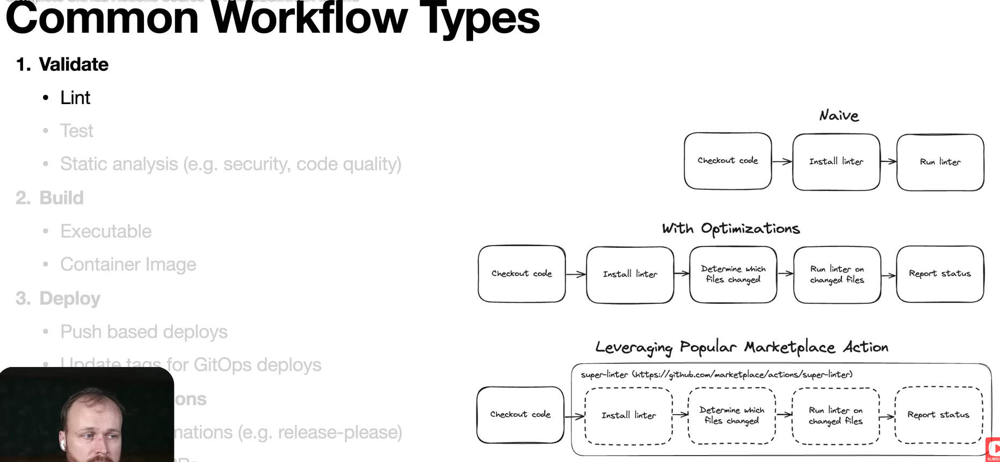
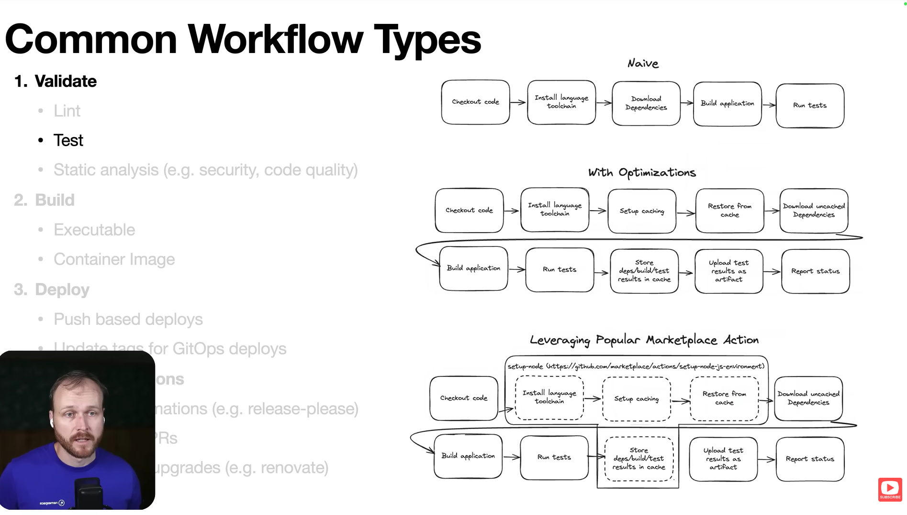
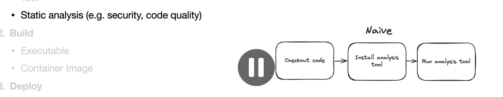
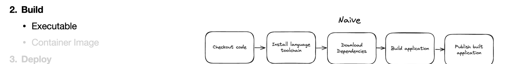
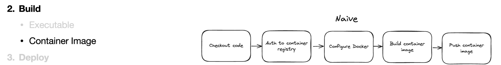
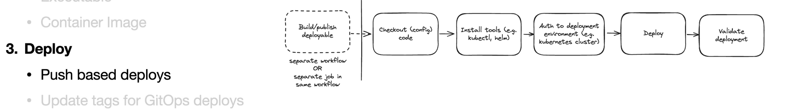
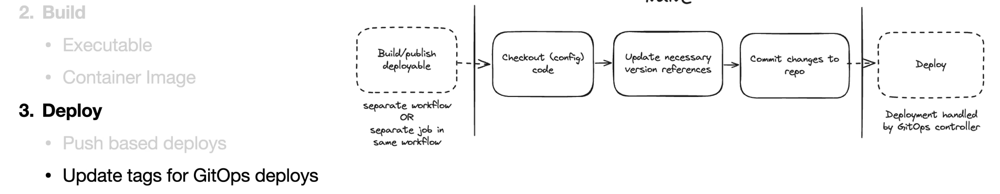
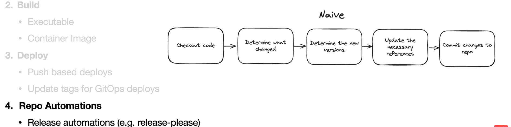
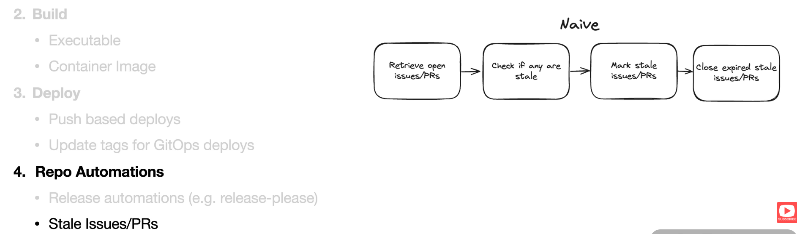
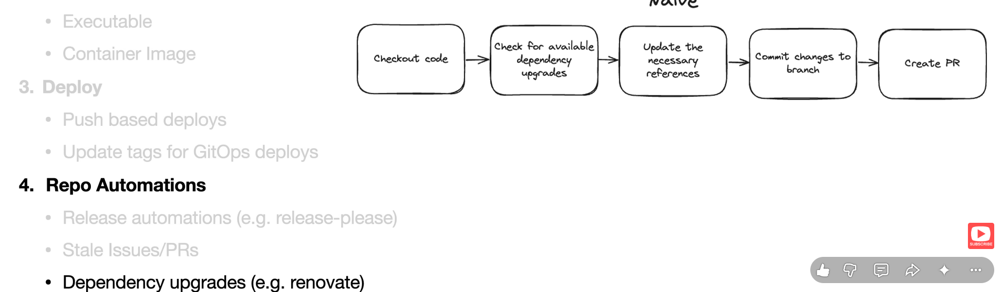

# GitHub Actions – CI/CD Workflow Reference

A practical reference guide to commonly used GitHub Actions workflows, including CI/CD automation, testing, security scanning, building, deployment, and repository management.

## Table of Contents

1. [Inter-Job Output → Input](#1-inter-job-output--input)
2. [Code Linting](#2-code-linting)
3. [Automated Testing](#3-automated-testing)
4. [Security Scanning](#4-security-scanning)
5. [Building Executables](#5-building-executables)
6. [Building Container Images](#6-building-container-images)
7. [Push-Based Deployment](#7-push-based-deployment)
8. [GitOps Deployment](#8-gitops-deployment)
9. [Repository Automation](#9-repository-automation)
10. [Release Automation](#10-release-automation)
11. [Stale Issues / Pull Requests](#11-stale-issues--pull-requests)
12. [Dependency Upgrades](#12-dependency-upgrades)

---

## 1. Inter-Job Output → Input


**Purpose:** Share data between different jobs in a GitHub Actions workflow.

GitHub Actions jobs run independently. To transfer data between jobs, we use job outputs.

**Example:**

```yaml
name: Inter-Job Communication

on:
  workflow_dispatch:

jobs:
  generate:
    runs-on: ubuntu-latest
    outputs:
      message: ${{ steps.set-output.outputs.message }}

    steps:
      - name: Generate output
        id: set-output
        run: echo "message=Hello from Job 1" >> $GITHUB_OUTPUT

  consume:
    runs-on: ubuntu-latest
    needs: generate

    steps:
      - name: Read output
        run: echo "${{ needs.generate.outputs.message }}"
```

**Important concepts:**

- `$GITHUB_OUTPUT`: Stores step outputs.
- `id`: Identifies the step.
- `outputs`: Exposes a step output at the job level.
- `needs`: Defines a dependency on another job.
- `needs.generate.outputs.message`: Reads the output from another job.

**Use case:** Pass build versions, image tags, deployment environments, or generated values between jobs.

---

## 2. Code Linting



**Purpose:** Automatically identify coding style issues, formatting problems, and potential errors before merging code.

**Example:**

```yaml
name: Lint

on:
  push:
    branches: [main]
  pull_request:

jobs:
  lint:
    runs-on: ubuntu-latest

    steps:
      - name: Checkout code
        uses: actions/checkout@v4

      - name: Setup Node.js
        uses: actions/setup-node@v4
        with:
          node-version: 20

      - name: Install dependencies
        run: npm ci

      - name: Run ESLint
        run: npm run lint
```

**Common linting tools:**

- ESLint – JavaScript / TypeScript
- Pylint – Python
- Ruff – Python
- Prettier – Code formatting
- ShellCheck – Shell scripts

**Use case:** Maintain consistent code quality across a development team.

---

## 3. Automated Testing



**Purpose:** Automatically execute tests whenever developers push code or create pull requests.

**Example:**

```yaml
name: Testing

on:
  push:
    branches: [main]
  pull_request:

jobs:
  test:
    runs-on: ubuntu-latest

    steps:
      - name: Checkout code
        uses: actions/checkout@v4

      - name: Setup Node.js
        uses: actions/setup-node@v4
        with:
          node-version: 20

      - name: Install dependencies
        run: npm ci

      - name: Run tests
        run: npm test
```

**Types of testing:**

- Unit Testing – Tests individual functions or components.
- Integration Testing – Tests interaction between multiple modules.
- End-to-End Testing – Tests complete application workflows.
- API Testing – Tests API endpoints and responses.

**Popular testing tools:** Jest, Vitest, Pytest, Playwright, and Cypress.

**Use case:** Detect bugs before code reaches production.

---

## 4. Security Scanning



**Purpose:** Automatically identify security vulnerabilities in source code and dependencies.

**Example: CodeQL**

```yaml
name: Security Scan

on:
  push:
    branches: [main]
  pull_request:
  schedule:
    - cron: '0 0 * * 1'

jobs:
  security:
    runs-on: ubuntu-latest

    permissions:
      security-events: write
      contents: read
      actions: read

    steps:
      - name: Checkout code
        uses: actions/checkout@v4

      - name: Initialize CodeQL
        uses: github/codeql-action/init@v4
        with:
          languages: javascript-typescript

      - name: Build application
        uses: github/codeql-action/autobuild@v4

      - name: Perform security analysis
        uses: github/codeql-action/analyze@v4
```

**Common security tools:**

- CodeQL – Static Application Security Testing (SAST).
- Trivy – Container and filesystem vulnerability scanning.
- Dependabot – Dependency vulnerability alerts and updates.
- OWASP Dependency-Check – Dependency vulnerability analysis.
- Gitleaks – Detects exposed secrets in repositories.

**Use case:** Detect vulnerable dependencies, insecure code, and exposed secrets before deployment.

---

## 5. Building Executables



**Purpose:** Compile source code into executable files or generate distributable build artifacts.

This is useful for applications written in languages such as C, C++, Go, Java, and .NET.

**Example: Go application**

```yaml
name: Build Executable

on:
  push:
    branches: [main]

jobs:
  build:
    runs-on: ubuntu-latest

    steps:
      - name: Checkout code
        uses: actions/checkout@v4

      - name: Setup Go
        uses: actions/setup-go@v5
        with:
          go-version: '1.24'

      - name: Build executable
        run: go build -o app

      - name: Upload executable
        uses: actions/upload-artifact@v4
        with:
          name: application
          path: app
```

**Important concepts:**

- Compile source code.
- Generate executable binaries.
- Upload build artifacts.
- Download artifacts in other jobs.

**Use case:** Generate downloadable executables without requiring users to compile the source code themselves.

---

## 6. Building Container Images



**Purpose:** Build Docker images and optionally push them to a container registry such as Docker Hub or GitHub Container Registry (GHCR).

**Example:**

```yaml
name: Docker Build

on:
  push:
    branches: [main]

jobs:
  docker:
    runs-on: ubuntu-latest

    permissions:
      contents: read
      packages: write

    steps:
      - name: Checkout code
        uses: actions/checkout@v4

      - name: Login to GHCR
        uses: docker/login-action@v3
        with:
          registry: ghcr.io
          username: ${{ github.actor }}
          password: ${{ secrets.GITHUB_TOKEN }}

      - name: Build and Push Image
        uses: docker/build-push-action@v6
        with:
          context: .
          push: true
          tags: ghcr.io/${{ github.repository }}:latest
```

**Important concepts:**

- Dockerfile – Defines how the image is built.
- Docker Buildx – Provides advanced image-building capabilities.
- Container Registry – Stores container images.
- Image Tag – Identifies a particular image version.

**Popular container registries:** Docker Hub, GHCR, Amazon ECR, Google Artifact Registry, and Azure Container Registry.

**Use case:** Package an application into a portable container image and publish it to a registry.

---

## 7. Push-Based Deployment



**Purpose:** Automatically deploy an application after a successful build by pushing the latest changes or artifacts directly to the deployment platform.

**Workflow:**

```text
Developer pushes code
        |
        v
GitHub Actions
        |
        v
Build Application
        |
        v
Deploy to Server / Platform
        |
        v
Application Updated
```

**Example: Deploy to a server using SSH**

```yaml
name: Push Based Deployment

on:
  push:
    branches: [main]

jobs:
  deploy:
    runs-on: ubuntu-latest

    steps:
      - name: Checkout code
        uses: actions/checkout@v4

      - name: Deploy through SSH
        uses: appleboy/ssh-action@v1
        with:
          host: ${{ secrets.SERVER_HOST }}
          username: ${{ secrets.SERVER_USER }}
          key: ${{ secrets.SERVER_SSH_KEY }}
          script: |
            cd /opt/myapp
            git pull origin main
            docker compose up -d --build
```

**Important concepts:**

- SSH – Secure remote server access.
- Secrets – Store server credentials securely.
- Deployment – Update the application on the target server.

**Use case:** Automatically deploy applications to VPS, cloud servers, or supported hosting platforms.

---

## 8. GitOps Deployment



**Purpose:** Manage infrastructure and application deployments through Git repositories.

In GitOps, Git acts as the source of truth for the desired application state.

Instead of directly deploying changes to the cluster, CI updates the deployment configuration or image tag in a GitOps repository. A GitOps controller then detects the changes and synchronizes the cluster.

**Workflow:**

```text
Developer pushes code
        |
        v
GitHub Actions
        |
        v
Build Docker Image
        |
        v
Push Image to Registry
        |
        v
Update Kubernetes Manifest
        |
        v
Commit / Push Updated Tag
        |
        v
GitOps Controller (Argo CD / Flux)
        |
        v
Kubernetes Cluster Updated
```

**Example: Update image tag in a GitOps repository**

```yaml
name: Update GitOps Image

on:
  workflow_dispatch:

jobs:
  update:
    runs-on: ubuntu-latest

    steps:
      - name: Checkout GitOps Repository
        uses: actions/checkout@v4
        with:
          repository: username/gitops-repo
          token: ${{ secrets.GITOPS_TOKEN }}
          path: gitops

      - name: Update image tag
        run: |
          cd gitops
          sed -i 's|image: myapp:.*|image: myapp:v2.0.0|' \
            kubernetes/deployment.yaml

      - name: Commit and push
        run: |
          cd gitops
          git config user.name "github-actions[bot]"
          git config user.email "41898282+github-actions[bot]@users.noreply.github.com"
          git add .
          git commit -m "Update application image"
          git push
```

**Popular GitOps tools:** Argo CD and Flux CD.

**Use case:** Maintain version-controlled Kubernetes deployments with automatic reconciliation.

---

## 9. Repository Automation



**Purpose:** Automate repetitive repository management tasks.

Examples include:

- Automatically label pull requests.
- Assign reviewers.
- Enforce branch naming conventions.
- Validate pull request titles.
- Automatically close or manage issues.
- Run repository maintenance tasks.

**Example: Automatic PR labeling**

```yaml
name: PR Labeler

on:
  pull_request_target:
    types: [opened, synchronize, reopened]

jobs:
  label:
    runs-on: ubuntu-latest

    permissions:
      contents: read
      pull-requests: write

    steps:
      - name: Apply labels
        uses: actions/labeler@v5
```

The repository needs a `.github/labeler.yml` configuration file defining the labeling rules.

**Use case:** Reduce manual repository management and improve team collaboration.

---

## 10. Release Automation



**Purpose:** Automatically create software releases, version tags, and release notes when a new version is published.

**Example:**

```yaml
name: Release

on:
  push:
    tags:
      - 'v*'

permissions:
  contents: write

jobs:
  release:
    runs-on: ubuntu-latest

    steps:
      - name: Checkout code
        uses: actions/checkout@v4
        with:
          fetch-depth: 0

      - name: Create GitHub Release
        env:
          GH_TOKEN: ${{ secrets.GITHUB_TOKEN }}
        run: |
          gh release create "${GITHUB_REF_NAME}" \
            --generate-notes \
            --title "Release ${GITHUB_REF_NAME}"
```

**Example version tags:**

- `v1.0.0` – Initial release.
- `v1.1.0` – New features.
- `v1.1.1` – Bug fixes.
- `v2.0.0` – Major changes.

**Popular release tools:** Semantic Release, Release Please, Changesets, and GitHub CLI.

**Use case:** Automate versioning, release creation, and changelog generation.

---

## 11. Stale Issues / Pull Requests



**Purpose:** Automatically identify inactive issues and pull requests and close them after a defined period of inactivity.

**Example:**

```yaml
name: Stale Issues and PRs

on:
  schedule:
    - cron: '0 0 * * *'

  workflow_dispatch:

permissions:
  issues: write
  pull-requests: write

jobs:
  stale:
    runs-on: ubuntu-latest

    steps:
      - name: Mark stale issues and PRs
        uses: actions/stale@v9
        with:
          days-before-stale: 30
          days-before-close: 7
          stale-issue-label: stale
          stale-pr-label: stale
          stale-issue-message: >
            This issue has been inactive for 30 days.
          stale-pr-message: >
            This pull request has been inactive for 30 days.
```

**How it works:**

1. GitHub Actions runs daily.
2. Checks inactive issues and pull requests.
3. Adds a stale label after 30 days.
4. Closes them after another 7 days of inactivity.

**Use case:** Keep repositories organized and reduce inactive issues and pull requests.

---

## 12. Dependency Upgrades

**Purpose:** Automatically detect outdated dependencies and create pull requests to upgrade them.

**Example: Renovate**

Renovate is an automated dependency management tool that scans project dependency files and creates pull requests when newer versions are available.

Create a `renovate.json` file in the repository root:

```json
{
  "$schema": "https://docs.renovatebot.com/renovate-schema.json",
  "extends": ["config:recommended"],
  "schedule": ["before 6am on Monday"],
  "prConcurrentLimit": 5
}
```

**Renovate supports:**

- npm dependencies
- Python packages
- Docker image versions
- GitHub Actions versions
- Terraform providers
- Kubernetes-related dependencies

**Popular dependency management tools:** Renovate and Dependabot.

**How it works:**

1. Renovate scans dependency files.
2. Checks for newer package versions.
3. Creates pull requests for available upgrades.
4. CI workflows run tests on those changes.
5. Developers review and merge the pull requests.

**Use case:** Keep project dependencies updated and reduce security risks from outdated packages.

---

# Quick Reference

| Automation | Purpose | Common Tool |
|---|---|---|
| Inter-Job Output → Input | Share data between jobs | `$GITHUB_OUTPUT`, `needs` |
| Linting | Check code quality | ESLint, Ruff |
| Testing | Verify application behavior | Jest, Pytest |
| Security | Detect vulnerabilities | CodeQL, Trivy |
| Executable Build | Generate binaries | Go, Maven, GCC |
| Container Build | Build and publish images | Docker Buildx |
| Push Deployment | Deploy directly to servers | SSH, cloud APIs |
| GitOps Deployment | Reconcile desired state | Argo CD, Flux |
| Repository Automation | Manage PRs and labels | Actions Labeler |
| Release Automation | Create versions and releases | Semantic Release |
| Stale Management | Handle inactive issues/PRs | Actions Stale |
| Dependency Upgrades | Update packages automatically | Renovate, Dependabot |

---

# Recommended CI/CD Pipeline Architecture

A typical production pipeline combines several of these workflows.

```text
                 Developer Push / PR
                         |
                         v
                    Code Checkout
                         |
                         v
                    Code Linting
                         |
                         v
                  Automated Testing
                         |
                         v
                  Security Scanning
                         |
                         v
                   Build Application
                         |
                         v
                 Build Container Image
                         |
                         v
                  Push to Registry
                         |
                         v
                 Deployment Approval
                         |
                         v
                  Deployment Strategy
                    /           \
                   v             v
             Push-Based         GitOps
              Deploy             Deploy
                   \             /
                    v           v
                  Health Check
                         |
                         v
                  Application Live
```

**Important:** In a real production workflow, deployment should happen only after the required CI checks pass. Production deployment can also include manual approval through GitHub Environments.

---

## Useful Official Documentation

- [GitHub Actions Documentation](https://docs.github.com/en/actions)
- [GitHub Actions Marketplace](https://github.com/marketplace?type=actions)
- [Docker Build Push Action](https://github.com/docker/build-push-action)
- [GitHub CodeQL](https://codeql.github.com/)
- [Argo CD Documentation](https://argo-cd.readthedocs.io/)
- [Flux CD Documentation](https://fluxcd.io/)
- [Renovate Documentation](https://docs.renovatebot.com/)
- [Semantic Release Documentation](https://semantic-release.gitbook.io/semantic-release/)

---

**Learning Goal:** Understand how GitHub Actions automates the complete software delivery lifecycle — from code validation and testing to containerization, deployment, release management, and repository maintenance.